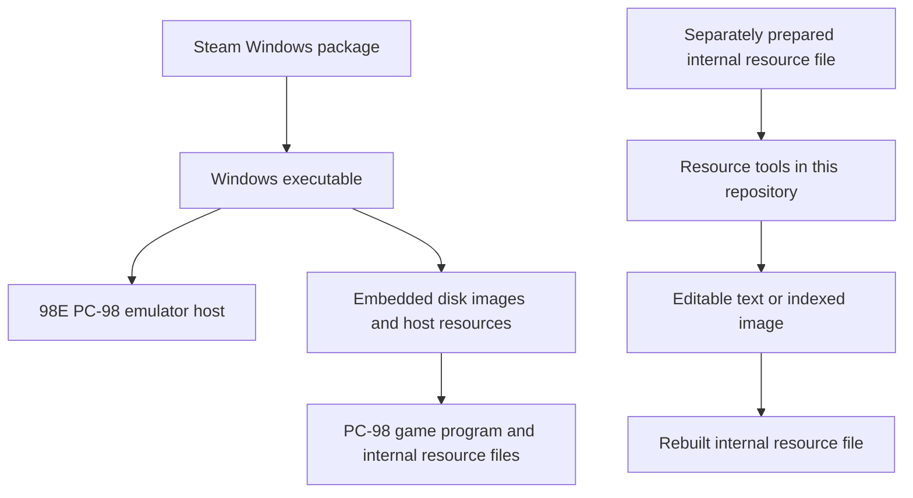

# Observed package architecture

This describes the inspected Windows edition of Uncharted Waters II distributed
on Steam. It is an observation about that sample, not a specification for all
Steam games, all releases of this game or every version of the host.

The inspected executable includes a SteamStub wrapper. The 98E host supplies the
Windows-facing execution environment for the PC-98 game. Disk images and host
resources are embedded in the distribution rather than delivered as a directory
of the internal game files accepted by this tool.

The original sample uses floppy-disk images. A separately constructed hard-disk
image is a different artifact and should not be described as the original Steam
delivery format.

Within the game's files, some resources use offset tables; others use internal
archives that contain additional text or image resources. Editing those formats
is a separate operation from preparing the input files or running the game.

The diagram is a component map, not an extraction procedure. This repository
starts at the separately prepared resource file. It contains no implementation
of the packaging layers above that boundary.

## Observations and hypotheses

The separation between a host and guest resources suggests that other
compatibility experiments may be possible. That is a hypothesis, not a promise
that arbitrary software, images or another host version will work. No test of
those possible uses is required to label the idea as a hypothesis, and no such
test is claimed here.

These observations do not establish permission to redistribute the original host,
game files or extracted assets.
