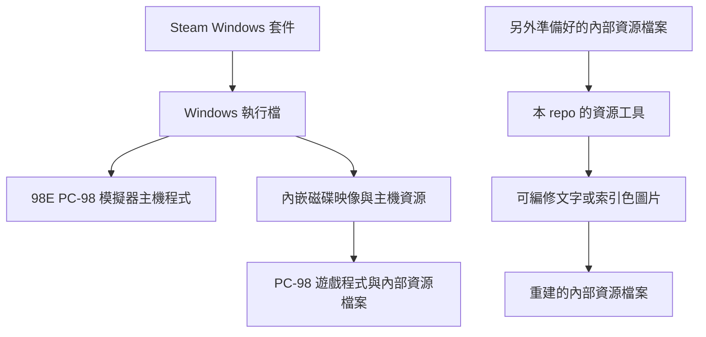

# 套件架構觀察

[English](architecture.md) | 繁體中文（台灣）

本文描述實際檢視過的 Steam Windows 版《大航海時代 II》套件。內容是對該份
樣本的觀察，不代表所有 Steam 遊戲、本遊戲的所有發行版本或每個主機程式版本
都採用相同架構。

檢視過的執行檔包含 SteamStub 包裝層。98E 主機程式提供 PC-98 遊戲在 Windows
上執行所需的環境。磁碟映像與主機資源內嵌於發行套件，而不是直接以本工具可接受的
遊戲內部檔案目錄形式提供。

原始樣本使用軟碟映像。後續另外製作的硬碟映像是不同的產物，不應將其描述成
Steam 原始交付格式。

遊戲檔案中的部分資源使用偏移量表；其他資源則位於內部封存檔，內含更多文字或
圖片資源。編修這些格式，與準備輸入檔案或執行遊戲，是不同的操作。

上圖僅說明元件關係，不是提取步驟。本 repo 從另外準備好的內部資源檔案開始處理，
未實作這個輸入邊界之前的套件包裝層。

## 觀察與推測

主機程式與客體資源分離的結構，讓其他相容性實驗在概念上可能存在。這只是推測，
不保證任意軟體、映像或其他主機程式版本都能運作。將想法明確標示為推測，不需要
先實測所有可能用途；本文也沒有宣稱做過這類測試。

這些觀察不構成重新散布原始主機程式、遊戲檔案或提取素材的許可。
